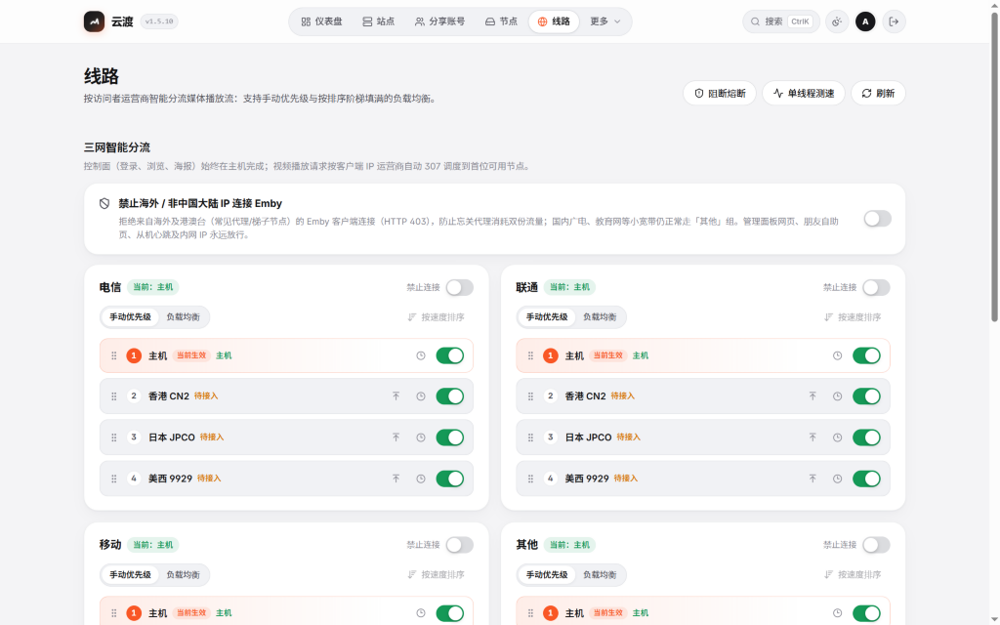
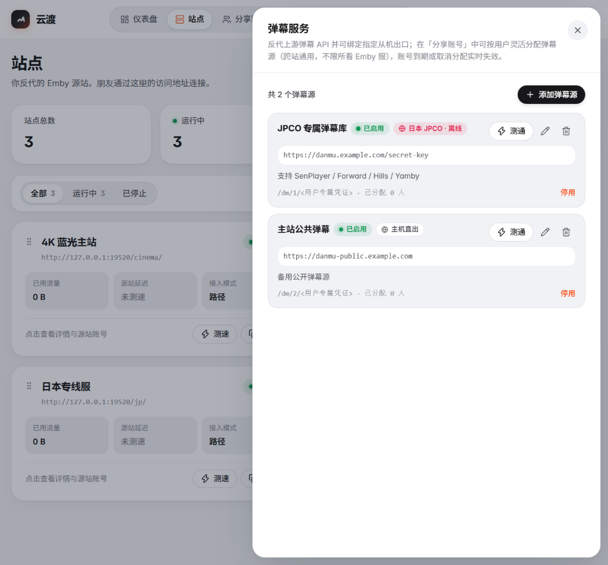
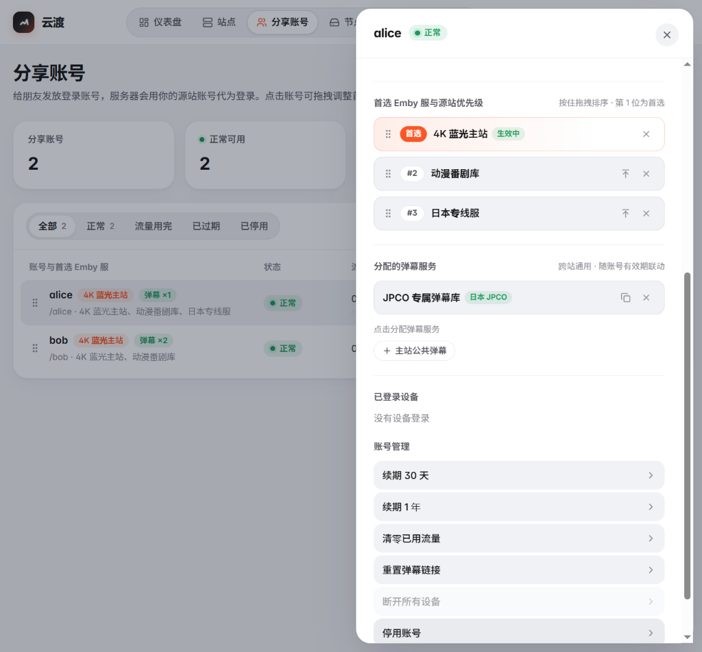
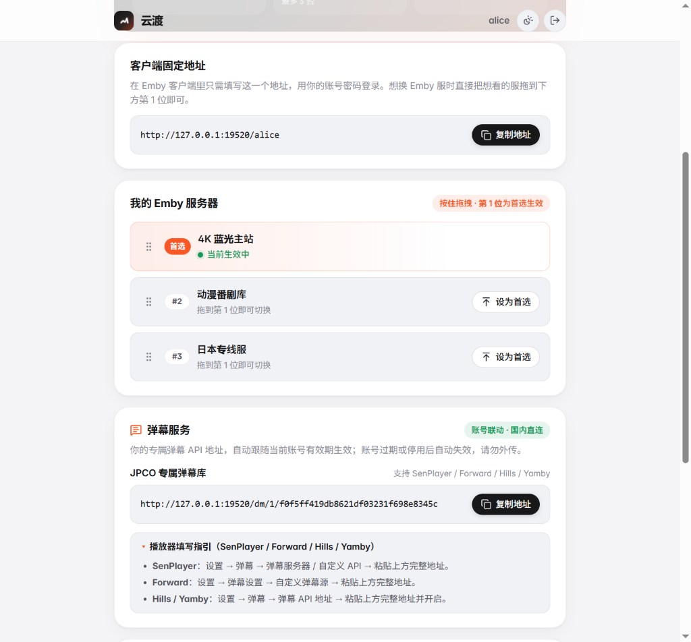
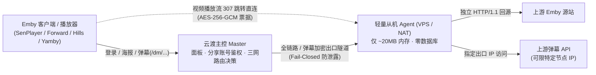

<div align="center">


# 云渡 · Yundu

**单文件 Emby 多站点反代 & 主从机三网智能分流面板**

把多台 Emby 源站与手里闲置的线路鸡 / NAT 小鸡整合成丝滑的观影网络：<br/>
**源站账号永不外泄 · 电信/联通/移动智能分流 · 同源单 IP 防封 · 账号联动弹幕反代**

[](https://github.com/SonthyR/EMBY/releases)
[](https://github.com/SonthyR/EMBY/actions/workflows/ci.yml)
[](https://github.com/SonthyR/EMBY/pkgs/container/yundu)
[](go.mod)
[](LICENSE)

[核心亮点](#核心亮点) · [界面预览](#界面预览) · [架构与分流](#架构与流量路径) · [快速部署](#快速部署) · [从机接入](#添加轻量从机vps--nat-小鸡) · [更新记录](CHANGELOG.md)

</div>

---

## 为什么做云渡？

- **手里有多台线路鸡 / NAT 小鸡，想按三网就近加速 Emby**：一台主控统一管理，从机仅一个轻量 Go Agent（内存约 `15–25 MB`，支持 Debian / Ubuntu / Alpine / NAT 端口映射），电信 / 联通 / 移动各自按优先级、负载均衡与分时避峰自动调度。
- **想把 Emby 安全分享给亲友，不想暴露源站密码，也不想折腾多套地址**：给朋友发独立账号 + 专属固定后缀（如 `/alice`），源站由云渡代登；朋友在自助页拖拽即可无感切服（正在播放不中断，看完自动切），还能防朋友忘关海外代理烧双倍流量。
- **遇到限 IP 的严格源站或赠送弹幕 API**：支持**同源单 IP 全链路**与**指定从机出口弹幕反代**（Fail-Closed 强绑定，从机离线直接拒绝，绝不回落主机 IP 泄露），且弹幕与分享账号有效期实时联动。

---

## 界面预览

<table>
  <tr>
    <td width="50%">
      
      <p align="center"><b>三网智能分流 & 禁止海外代理 IP</b><br/><sub>电信 / 联通 / 移动独立排序、负载均衡、分时避峰与阻断熔断</sub></p>
    </td>
    <td width="50%">
      
      <p align="center"><b>多站点反代 & 弹幕服务管理</b><br/><sub>弹幕源可绑定指定从机出口（强绑定防泄露），支持一键测通</sub></p>
    </td>
  </tr>
  <tr>
    <td width="50%">
      
      <p align="center"><b>分享账号管理 & 按用户灵活分配弹幕</b><br/><sub>拖拽调整首选 Emby 服，弹幕源与站点解耦、跨站按人分配</sub></p>
    </td>
    <td width="50%">
      
      <p align="center"><b>朋友自助页（/me）</b><br/><sub>客户端固定地址、拖拽切服、专属弹幕地址与播放器填写指引</sub></p>
    </td>
  </tr>
</table>

---

## 核心亮点

### 1. 主从机架构 & 三网智能分流（兼容普通 VPS 与 NAT 小鸡）
- **极简轻量从机**：同一个单文件二进制内置 `meridian agent` 从机模式，无数据库、无面板，内存仅占约 `15–25 MB`，支持 `systemd` 与 Alpine `OpenRC`。
- **NAT 友好 & 自动泛域名 HTTPS**：添加从机只需填**名称 + 对外端口**，首次心跳自动上报公网 IP 接入；可选绑定主机泛域名子域名，从机自动同步主控证书，任意端口同端口兼容 HTTP/HTTPS。
- **三网独立调度**：按**电信 / 联通 / 移动 / 其他**四个运营商分组拖拽排序，支持**手动优先级**、**按排序阶梯填满的负载均衡**与**分时避峰策略**；内置基于纯 Go 零依赖离线 `ip2region`（IPv4 + IPv6）的本地路由识别，不向任何第三方上传访客 IP。
- **三网主动阻断探测与自动熔断**：支持按单节点切换 **TCP 握手 / ICMP Ping / 关闭主动探测**（适配禁出站 TCP 的优化线路机），三地目标连续失败自动熔断切流并推送 Telegram 告警，恢复后自动复活。
- **防误开代理烧流量**：一键**禁止海外 / 非中国大陆 IP 连接 Emby**（返回 `403`），避免亲友忘关 VPN/代理消耗双倍流量，同时面板网页、朋友自助页与从机心跳永远放行。
- **高码率 4K 稳定转发**：主从机回源统一采用独立 **HTTP/1.1** 连接与 `128 KB` 转发缓冲，彻底避免多路 4K 并发挤占同一 HTTP/2 连接导致的卡顿与意外退出播放。

### 2. 严格源站保护 & 弹幕服务反代
- **同源单 IP 全链路模式**：针对限制多 IP / 跨区登录的严格 Emby 站，可将站点设为「同源单 IP 全链路」——登录、API、WebSocket、视频播放与注销全程经同一从机加密隧道（`/_yundu/egress` AES-256-GCM）出站，从机离线时 **Fail-Closed** 拒绝回落，绝不泄露主机 IP。
- **多源站账号负载均衡与故障切换**：同一站点保存多个源站号时，自动选择活跃会话最少的账号代登，遇 `401 / 403 / 429` 自动切换备用号。
- **专属弹幕服务（v1.5.10 新增）**：
  - 管理端可配置多个上游弹幕 API（隐藏上游地址与密钥）并绑定指定从机出口（同样 Fail-Closed 防泄露，支持一键连通性测试）；
  - **与 Emby 站点完全解耦**：在「分享账号」中可按用户灵活分配任意弹幕源（看其他 Emby 站点也能共用同一弹幕源）；
  - 每位用户拥有独立 `/dm/{id}/{token}` 链接，**实时联动账号生命周期**——未分配、账号过期、停用或流量耗尽立即返回 `403`，支持单用户一键重置凭证；
  - 分享用户自助页提供独立「弹幕服务」卡片、一键复制与 **SenPlayer / Forward / Hills / Yamby** 填写指引。

### 3. 亲友分享账号 & 自助体验
- **专属固定入口 + 无感切服**：为朋友分配专属后缀（如 `https://emby.example.com/alice`），客户端只需填这一个地址；朋友登录网页拖拽即可切换 Emby 服，**正在看片时不会中断，关闭视频后自动生效**。
- **精细配额与风控**：有效期（含续期）、流量额度与每月固定重置日、同时在线设备上限、全局限速、客户端黑/白名单（防下载器与刮削脚本）、单设备精确踢下线、过期/超额自动本地拉黑并向源站注销。
- **兑换码 / 卡密自助**：支持批量生成**续期码**与**开号兑换码**，朋友在自助页自助续期或在登录页凭码注册并自动分配专属后缀。
- **完善运维**：仪表盘实时观影监控、内置单线程回国测速、从机面板一键远程升级（SHA-256 校验原子替换）、Cloudflare 泛域名证书自动续期、加密备份/还原、Telegram Bot 管理与告警。

---

## 架构与流量路径



---

## 快速部署

### 方式一：Docker Compose（推荐）

首次启动时容器会自动生成 5 个独立随机密钥并持久化保存在 `./data/.meridian-secrets`，无需手动拼接复杂环境变量：

```yaml
services:
  yundu:
    image: ghcr.io/sonthyr/yundu:latest
    container_name: yundu
    restart: unless-stopped
    ports:
      - "9090:9090"
    volumes:
      - ./data:/app/data
    environment:
      - TZ=Asia/Shanghai
```

启动并查看首次初始化令牌（`SETUP_TOKEN`）：

```bash
docker compose up -d
docker compose logs yundu
```

打开 `http://<服务器IP>:9090`，使用日志中打印的 `SETUP_TOKEN` 创建管理员账号即可开始使用（生产环境建议在前端反代 HTTPS 或在面板内直接配置域名与 TLS 证书）。

> **升级镜像**：执行 `docker compose pull && docker compose up -d` 即可平滑升级，数据库与配置自动迁移保留。

### 方式二：Linux 一键安装脚本（裸机 systemd）

```bash
bash <(curl -fsSL https://raw.githubusercontent.com/SonthyR/EMBY/master/install.sh)
```

---

## 添加轻量从机（VPS / NAT 小鸡）

在主控面板进入 **节点 → 添加从机**，填写**节点名称**与**对外端口**（NAT 机填外网映射端口，并按需指定监听端口），点击创建后直接复制面板生成的一键安装命令到目标服务器执行：

```bash
bash <(curl -fsSL https://raw.githubusercontent.com/SonthyR/EMBY/master/install.sh) agent \
  --master https://你的主机面板域名 \
  --id 1 \
  --token 节点密钥 \
  --port 19090
```

彻底卸载从机（兼容 Debian / Ubuntu / CentOS 与 Alpine `ash`，不影响主机）：

```bash
curl -fsSL https://raw.githubusercontent.com/SonthyR/EMBY/master/uninstall-agent.sh | sh
```

---

## 从源码构建

需要 Go `1.26.11+` 与 Node.js `22+`（如需修改前端 UI）：

```bash
# 如修改了 ui/ 前端代码，先构建内嵌静态资源
cd ui && npm ci && npx vite build && cd ..

# 编译单文件二进制（零 CGO）
CGO_ENABLED=0 go build -trimpath -buildvcs=false -o yundu ./cmd/yundu
```

裸跑二进制前请设置 5 个互不相同的 32+ 字节密钥：`JWT_SECRET`、`UPSTREAM_HEADER_KEY`、`DYNAMIC_ROUTE_KEY`、`MERIDIAN_SECRET_KEY`、`SETUP_TOKEN`，然后运行 `./yundu --port 9090 --db ./data/yundu.db`。更多说明见 [docs/wiki](docs/wiki)。

---

## 版本与开源致谢

- **最新发布**：[`v1.5.10`](https://github.com/SonthyR/EMBY/releases/tag/v1.5.10) · [完整更新记录](CHANGELOG.md)
- **开源协议**：[MIT License](LICENSE)
- **致谢上游**：云渡基于 [snnabb/Meridian](https://github.com/snnabb/Meridian) `v1.14.2`（MIT）二次开发，完整保留原作者版权声明；上游原始说明见 [docs/MERIDIAN-README.md](docs/MERIDIAN-README.md)。
- **定位说明**：本项目面向个人多线路 Emby 体验优化与亲友小范围分享，请遵守所在地区法律法规及上游媒体服务器的使用条款。
